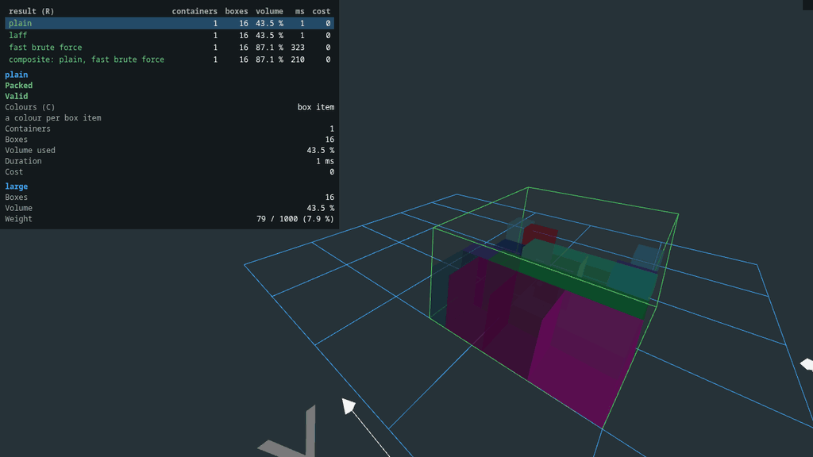

 
[](https://mvnrepository.com/artifact/com.github.skjolber.3d-bin-container-packing)

# 3d-bin-container-packing

This library does 3D rectangular bin packing; it attempts to match a set of 3D items to one or more in a set of 3D containers. The result can be constrained to a maximum number of containers.

Projects using this library will benefit from:

 * short and predictable calculation time,
 * fairly good use of container space, 
 * brute-force support for low number of boxes (ideal for small orders)

with

 * friendly API
 * customizable packagers
    
Bugs, feature suggestions and help requests can be filed with the [issue-tracker].

See [FEATURES.md](FEATURES.md) for a capability overview, including which packager supports which
feature (generated from the conformance tests), known limitations and non-goals.

## Point calculators

Custom packing algorithms can use `PointCalculator.addLast(point, placement)` for their final box to avoid
calculating unused free space. Clear or restore the calculator before continuing a search;
see [point calculators](docs/point-calculators.md) for the contract and an example.

## Obtain
The project is implemented in Java and built using [Maven]. The project is available on the central Maven repository.

For the previous version, see the [4.x](https://github.com/skjolber/3d-bin-container-packing/tree/4.x) branch. See [the migration guide](legacy/MIGRATION-v4-TO-v5.md) for upgrading from 4.x to 5.0.

<details>
  <summary>Maven coordinates</summary>

Add
 
```xml
<3d-bin-container-packing.version>5.0.x</3d-bin-container-packing.version>
```

and

```xml
<dependency>
    <groupId>com.github.skjolber.3d-bin-container-packing</groupId>
    <artifactId>core</artifactId>
    <version>${3d-bin-container-packing.version}</version>
</dependency>
```

Add the optional result validators separately when needed:

```xml
<dependency>
    <groupId>com.github.skjolber.3d-bin-container-packing</groupId>
    <artifactId>validators</artifactId>
    <version>${3d-bin-container-packing.version}</version>
</dependency>
```

</details>

or

<details>
  <summary>Gradle coordinates</summary>

For

```groovy
ext {
  containerBinPackingVersion = '5.0.x'
}
```

add

```groovy
api("com.github.skjolber.3d-bin-container-packing:core:${containerBinPackingVersion}")
// optional result validators
api("com.github.skjolber.3d-bin-container-packing:validators:${containerBinPackingVersion}")
```

</details>

# Usage
The units of measure is out-of-scope, be they cm, mm or inches.

Obtain a `Packager` instance, then then compose your container and product list:

```java
List<BoxItem> products = new ArrayList<>();

products.add(new BoxItem(Box.newBuilder().withId("Shoes").withSize(6, 10, 2).withRotate3D().withWeight(25).build(), 1));
products.add(new BoxItem(Box.newBuilder().withId("Pants").withSize(4, 10, 1).withRotate3D().withWeight(25).build(), 1));
products.add(new BoxItem(Box.newBuilder().withId("Hat").withSize(4, 10, 2).withRotate3D().withWeight(50).build(), 1));

// add a single container type
Container container = Container.newBuilder()
    .withDescription("1")
    .withSize(10, 10, 3)
    .withEmptyWeight(1)
    .withMaxLoadWeight(100)
    .build();
    
// with unlimited number of containers available
List<ContainerItem> containerItems = ContainerItem
    .newListBuilder()
    .withContainer(container)
    .build();
```

Pack all in a single container:

```java
PackagerResult result = packager
    .newResultBuilder()
    .withContainerItems(containerItems)
    .withBoxItems(products)
    .build();

if(result.isSuccess()) {
    Container match = result.get(0);
    
    List<Placement> placements = match.getStack().getPlacements();
    
    // ...
}
```

Use a maximum number of containers:

```java
int maxContainers = ...; // maximum number of containers which can be used

PackagerResult result = packager
    .newResultBuilder()
    .withContainerItems(containerItems)
    .withBoxItems(products)
    .withMaxContainerCount(maxContainers)
    .build();
```

Note that all `packager` instances are thread-safe.

### Plain packager
A [simple packager](docs/heuristics/plain.md), which places the box with the biggest volume first.

```java
PlainPackager packager = PlainPackager
    .newBuilder()
    .build();
```

### Largest Area Fit First (LAFF) packager
A [packager](docs/heuristics/largest-area-fit-first.md) using the LAFF algorithm, which fills the container level by level, starting each level with the box which covers the largest ground area. `FastLargestAreaFitFirstPackager` is a faster variant which stacks in 2D within each level.

```java
LargestAreaFitFirstPackager packager = LargestAreaFitFirstPackager
    .newBuilder()
    .build();
```

### Brute-force packager
For a low number of packages (like <= 6) the [brute-force packager](docs/heuristics/brute-force.md) might be a good fit. 

See also the `ParallelBruteForcePackager` and `FastBruteForcePackager` packagers. 

Using a deadline is recommended whenever brute-forcing in a real-time application:

```java
Packager packager = BruteForcePackager
    .newBuilder()
    .build();

PackagerResult result = packager
    .newResultBuilder()
    .withContainerItems(containerItems)
    .withBoxItems(products)
    .withInterruptDuration(1000) // milliseconds from now; or withInterruptDeadline(System.currentTimeMillis() + 1000)
    .build();
```

### Virtual-box preprocessing
[Virtual box packaging](docs/heuristics/virtual-box.md) simplifies packaging when there is more than one of the same box. `VirtualBoxPackager` wraps a packager, packs repeated boxes as filled rectangular assemblies, and expands the result back into the original boxes.

```java
try (BruteForcePackager delegate = BruteForcePackager.newBuilder().build();
     VirtualBoxPackager packager = new VirtualBoxPackager(delegate)) {
    PackagerResult result = packager.newResultBuilder()
        .withBoxItems(items)
        .withContainerItems(containers)
        .withMaxContainerCount(3)
        .withMaxLayouts(8)
        .withMaxRefinements(4)
        .withMaxDelegateBoxes(20)
        .withInterruptDuration(1000)
        .build();
}
```

# Packager customizations

## Load constraints
Boxes can limit what is stacked on top of them:

```java
Box box = Box.newBuilder()
    .withSize(400, 300, 200)
    .withWeight(12)
    .withRotate3D()
    .withMaxLoadWeight(50)          // total weight resting on the box, through all levels above
    .withMaxLoadPressure(0.001)     // weight per area unit
    .withMaxLoadBoxCount(4)         // boxes stacked on top
    .build();
```

Use `withMaxLoadIdenticalBoxCount(count)` to only allow boxes of the same type on top. The packagers
detect the constraints and enforce them.

## Insertion order
The placements of each container are in [insertion order](docs/insertion-order.md): the order in which the boxes can be loaded. 

Also set how boxes get into a container type with `withAccess(..)`:

```java
Container container = Container.newBuilder()
    .withSize(1200, 240, 260)
    .withMaxLoadWeight(25_000)
    .withAccess(ContainerAccess.FRONT) // a door at x = dx, loading from x = 0; or TOP; default ANY
    .build();
```

## Extraction order and container priority
[Delivery](docs/deliveries.md) details can be specified:

```java
// the stops of a delivery route: lower values are extracted first
BoxItem firstStop = new BoxItem(box, 2).withExtractionOrder(1);
BoxItem lastStop = new BoxItem(otherBox, 4).withExtractionOrder(3);

// urgent boxes in the first containers: lower values in earlier containers
BoxItem urgent = new BoxItem(box, 1).withContainerPriority(0);
BoxItem later = new BoxItem(otherBox, 1).withContainerPriority(1);

// for all the boxes of a group
BoxItemGroup group = new BoxItemGroup("order-1", items).withExtractionOrder(2);
```

 * **Extraction order**: within a container, no box rests on, or is in the path of (see `withAccess(..)`), a box
   which is extracted earlier, so the boxes of each stop can be taken out without moving the boxes for later stops.
 * **Container priority**: a hard constraint on which boxes go in earlier containers.

## Support
[Support](docs/support.md) (the area resting on boxes below) can be calculated, or full support required:

```java
PlainPackager packager = PlainPackager
    .newBuilder()
    .withCalculateSupport(true)     // prefer better supported placements
    .withRequireFullSupport(true)   // or: only place fully supported boxes
    .build();
```

The LAFF packager builders have the same options.

## Obstacles within containers
Make the packager account for non-rectangular packaging space, i.e. pillars or other obstacles within the container loading area.

## Container cost and packing strategies
Give container types [a cost](docs/container-costs.md) to prefer cheaper combinations of containers.

A [container packing strategy](docs/container-packing-strategies.md) decides which containers to use, and in which order.

## Validating results
The optional `validators` artifact checks packing results, for example the load constraints:

```java
LoadValidator validator = new DefaultLoadValidatorBuilder()
    .withPlacements(container.getStack().getPlacements())
    .build(); // null if no load constraints are present

List<ValidatorResultReason> reasons = new ArrayList<>();
boolean valid = validator.isValid(container.getStack().getPlacements(), reasons);
```

`DefaultValidator` validates a whole `PackagerResult` against the input: box counts, containment, intersecting boxes, that the obstacles of
the containers are left empty, insertion and extraction order, and the load constraints which the boxes declare (cheap if there are none).

The validator result says what was validated: `isLoadValidated()`, `isStabilityValidated()` and `hasLoadConstraints()` (if false, the load validation had nothing to check).

## Packager controls
The packagers (excluding brute force) can be extended to handle specialized needs via various [packager controls](docs/packager-controls.md) (plugins) types. 

In a nutshell, the `controls` are stateful objects which are handed various resources from the packagers during construction, and then notified and/or invoked at certain milestones within the packaging process.

Manifest controls and point controls belong to a container item, so container types can have different rules:

```java
Container container = ...;
ManifestControlsBuilderFactory manifestControls = ...; // your own implementation
PointControlsBuilderFactory pointControls = ...;       // your own implementation

PackagerResult result = packager
    .newResultBuilder()
    .withContainerItem(b -> b
        .withContainerItem(container, 5)
        .withManifestControlsBuilderFactory(manifestControls)
        .withPointControlsBuilderFactory(pointControls))
    .withBoxItems(products)
    .withMaxContainerCount(5)
    .build();
```

## Combining packagers
[CompositePackager](docs/heuristics/composite.md) uses costly packagers only where cheaper packagers fall short:

```java
CompositePackager packager = CompositePackager.newBuilder()
    .withPackager(PlainPackager.newBuilder().build())                // tried first, for every container
    .withPackager(FastBruteForcePackager.newBuilder().build(), 200)  // only where plain does not fit all boxes, for at most 200 ms
    .build();
```

# Visualizer
There is a simple output [visualizer](docs/visualizer.md) included in this project, based of [three.js](https://threejs.org/). This visualizer is currently intended as a tool for developing better algorithms; not as stacking instructions.



# Get involved
If you have any questions, comments or improvement suggestions, please file an issue or submit a pull-request. 

Note on bugs: Please follow [shuairan's](https://github.com/shuairan) example and [file a test case with a visualization](https://github.com/skjolber/3d-bin-container-packing/issues/574).

# License
[Apache 2.0]. Social media preview by [pch.vector on www.freepik.com](https://www.freepik.com/free-photos-vectors/people).

# Interesting links

 * [The Art of Stacking: Challenges Faced While Developing a Packing Algorithm](https://medium.com/@fayyazawais1412/the-art-of-stacking-challenges-faced-while-developing-a-packing-algorithm-64d869b924ab)

# History
 * 5.1.0:
     * New API: `PointCalculator.addLast(..)` places the final box without updating the free points.
     * Performance: Packagers are up to 6% faster, validation up to 16%, and point calculation up to 17%.
 * 5.0.0: Major release. Breaking changes. A ton of new features. Assisted by AI. 
     * Box load constraints: 
        * max load weight
        * pressure
        * box count
        * identical boxes only
     * Support calculation + full support for plain and LAFF packagers; full support for the brute-force packagers
     * Container costs and container packing strategies (ordered, parallel, allocation, brute force), and custom container packing strategies
     * Deliveries: 
        * extraction order (for example the stops of a route) 
        * container priority (for example urgent boxes in the first containers) of box items and groups
     * Visualizer: result summaries and comparison of several results, validation reasons on the boxes, colour modes for groups, support, load and extraction order, and the centre of gravity
     * Composite packager: Cheap packagers first, costly packagers only where needed
     * Virtual box: Combine multiple boxes into one to simplify the packaging.
     * Substantially faster point calculation, placement search, support calculation and load validation (see [jmh/PERFORMANCE.md](jmh/PERFORMANCE.md))
     * The 4.x implementation is [retained for testing](legacy/v4/README.md): 5.0 is verified against it with equivalence and golden-master tests and 10,000-order comparisons
     * Breaking changes and behaviour changes against 4.x: see [legacy/MIGRATION-v4-TO-v5.md](legacy/MIGRATION-v4-TO-v5.md)
 * 4.2.1: `Placement` can now be added anywhere within a `Point` (not only at the point origin).
 * 4.2.0: Obstacles.
 * 4.1.x: Validator.
 * 4.0.x: Major rewrite. Breaking changes.
     * Support for packaging groups
     * Various ways to control packaging:
        * Manifest controls (box vs box, box vs container)
        * Point controls (points per box)
        * Placement controls (select best box + point)
     * Minor visualizer improvements
 * 3.0.11: Use `BigInteger` to sanity-check max volume / max weight, calculate real remaining max volume.
 * 3.0.10: Fix module info, bump dependencies.
 * 3.0.9: Fix point support bug which resulted in invalid packaging result
 * 3.0.8: Visualization fix
 * 3.0.4-3.0.6: Fix issue #689
 * 3.0.3: Fix module info
 * 3.0.2: Make Plain Packager prefer low z coordinate over supported area.
 * 3.0.1: Various performance improvements.
 * 3.0.0: Support max number of containers (i.e. per container type). Use builders from now on. Various optimizations.
 * 2.1.4: Fix issue #574
 * 2.1.3: Fix null-pointer
 * 2.1.2: Tidy up, i.e. remove warnings, nuke some dependencies.
 * 2.1.1: Improve free space calculation performance
 * 2.1.0: Improve brute force iterators, respect deadlines in brute for packagers.

[Apache 2.0]: 		http://www.apache.org/licenses/LICENSE-2.0.html
[issue-tracker]:	https://github.com/skjolber/3d-bin-container-packing/issues
[Maven]:			http://maven.apache.org/
[LinkedIn]:			http://lnkd.in/r7PWDz
[Github page]:		https://skjolber.github.io
[NothinRandom]:		https://github.com/NothinRandom
