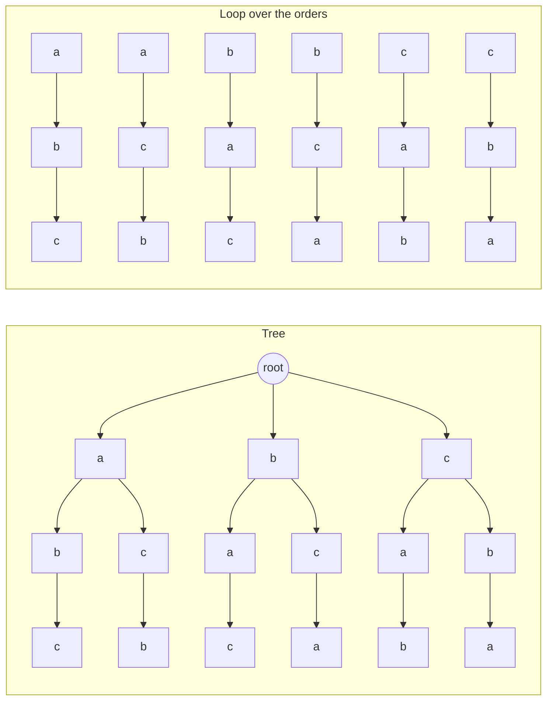

# Brute-force packagers

`BruteForcePackager` and `FastBruteForcePackager` search the box orders and rotations of each container, which is feasible for a low number of boxes.

## Algorithm

This algorithm has no logic for selecting the best box or rotation; running through all permutations, for each permutation all rotations:

 * `BruteForcePackager` attempts all box orders, rotations and placement positions.
 * `FastBruteForcePackager` attempts all box orders and rotations, placing each box at the best free point for its rotation.

The brute-force packagers use one search for every order of the boxes: each box in the order is tried in each rotation,
at each free point (the fast brute-force packager tries each rotation at its best point only), and a container gets the
best arrangement by the result comparator. Without a box item order (`Order.NONE`), every permutation of the boxes is
searched this way; with a box item order (`Order.CHRONOLOGICAL`), only that order, each box insertable after the boxes
before it. With skipping (`Order.CHRONOLOGICAL_ALLOW_SKIPPING`), each box (or box item group) can also be skipped, and
waits for a later container. With container priorities, they only permute the boxes within each priority.

```
orders:        a b c   a c b   b a c   b c a   c a b   c b a       every permutation of the boxes a, b, c

one order:     a  in each rotation, at each free point              (the fast packager: at the best free point of the rotation)
               └─ b  in each rotation, at each free point left
                  └─ c  in each rotation, at each free point left   a leaf is an arrangement; the best by the result comparator wins
```

For box item groups without a box item order, the packagers also search the orders of the groups, see
[deliveries](../deliveries.md#packager-support) and [FEATURES.md](../../FEATURES.md#packing-algorithms).

## Tree search

By default (`withTreeSearch(true)`) the box orders of a container are not searched one at a time but as one tree
(`BruteForceTreeSearch`): a node is a prefix of placed boxes (each in a rotation, at a position), and its children are
the remaining boxes in each rotation at each candidate position. Every prefix of placements is placed once, where the
loop over the orders places it again for every order which starts with it. The candidates of a box at a node are the
ones the packager's own search tries (`BruteForcePackager` all free points where the box fits, or the point filter's;
`FastBruteForcePackager` the best point per rotation), on the same point calculator, so the positions are the loop's.



Above, the loop over the orders of the boxes a, b, c: a is placed at the root twice, for a b c and for a c b, b twice
and c twice. Below, the tree, which places each of them once. A leaf is an arrangement: the boxes of an order, until one
has no position.

The result has the loop's value, and with `withTreeSearchAnyBest(false)` is exactly the loop's: the loop stops an order at
its first complete path (every box which fits the load limits placed) and keeps, among the orders, the best arrangement
by the result comparator (load volume, then weight, then boxes), the first order on ties. The tree keeps the orders
settled that way per type prefix (the orders through a prefix are a block of the lexicographic order), expands a prefix
only while an order through it is open, and compares equal arrangements by their first order. It also prunes with a bound: a box is not placed when the prefix, the box and
the best sub-multiset of the remaining boxes within the load limits cannot beat the best arrangement (computed once
per remaining multiset). When not all boxes fit the load limits, the largest boxes are tried first, so that a strong
arrangement is found early; once an arrangement places all boxes the search restarts in the lexicographic order, where
the first full arrangement ends it, as the loop ends at the first order which places all boxes. A node is also bounded by
its free space, kept as maximal empty spaces: the box types which fit none of them, in any rotation, can never be placed
below the node, so the prefix plus the remaining boxes of the other types must beat the best. That bound depends on the
positions, so it skips the node without settling its orders, which stay open on other paths. The free points cannot tell
this (a later box can add a point no earlier point covered, as a bar across two boxes), the maximal spaces can: a box fits
the free space if and only if it fits one of them. The check is made when a node's first child is about to be placed, so a
dead end never pays for it, and only where three more of the smallest remaining boxes fit the load left, where a cut saves
a subtree; a search gives the bound up when fewer than one node in sixteen checked is cut, and a search with box item
groups does without it (a box must be insertable after the groups before its own, so a free point which holds it is no
sign that it can be placed). A box type is first looked for at the free points (a free point which holds it is an empty region), then by the
answer kept from the node above with a space which holds it, then in the spaces of the nearest node above whose spaces
were computed; only then are the node's own spaces computed from its parent's, keeping the pieces which hold some
remaining box.

```
orders:      a b c   a c b   b a c   b c a   c a b   c b a
prefix a:    ^^^^^^^^^^^^^                                   the orders through a prefix are a block of the lexicographic order

a b c places every box, so the loop stops that order and skips a c b, which starts with the same boxes:
settled:     x x x   x x x   . . .   . . .   . . .   . . .   a is settled, b and c are still open

b a cannot be continued (no position for a after b), so the loop skips every order which starts with b a:
settled:     x x x   x x x   x x x   . . .   . . .   . . .   b a is settled, b c a is searched next

the bound:   prefix a b, volume 12  +  best sub-multiset of the remaining {c, d} within the load limits, volume 5  =  17
             below the best arrangement so far (18): a b is not expanded

free space:  prefix a b at these positions: c fits no maximal empty space, so only d can follow:  12 + 4  =  16
             below the best arrangement so far (18): this node is skipped, but a b is not settled
```

The tree applies to the search which the loop makes: no box item order, no container priorities and the default result
comparator; box item groups keep their sequence (the children of a node are the remaining boxes of the first group with
boxes remaining). A search of the orders of the groups keeps the tree's tables (the multiset keys, the bound and the
settled orders) over the group orders: an order of other boxes of the same counts and groups resets the bound and the
settled orders and keeps the keys and sequence counts. Other searches, reverse-filtered permutations (`withSkipReversePermutations(..)`), too many
distinct box multisets (over 2^18) and containers with fewer boxes than `withTreeSearchMinBoxes(..)` (default 6, where
the loop is quicker) use the loop. `withTreeSearch(false)` always uses the loop.

By default (`withTreeSearchAnyBest(true)`) the tree returns any arrangement of the best value (load volume, then
weight, then boxes), not necessarily the loop's choice among equally good ones (the first order's, its first rotations
and positions): the search ends at the first arrangement which places all boxes, tries the largest boxes first even when
all boxes fit, and does not expand prefixes which can at most tie the best. Where all boxes fit and the first order does
not place them all, this is the difference between finding the lexicographically first complete arrangement and any: on
the Bouwkamp benchmark (squared squares) the plain packager runs 260 times faster and the fast packager 12 times.
`withTreeSearchAnyBest(false)` gives the loop's arrangement, exactly.

```
exact:      a b c → a c b → b a c → ...     lexicographic order; ends at the first order which places all boxes
any best:   c ... → b ... → a ...           largest box first; ends at the first arrangement which places all boxes,
                                            and skips prefixes which can at most tie the best
```

With box load limits, removing a placement subtracts its shares from the loads below, which leaves floating-point
residue; the searches save the loads a placement changes and restore them exactly when it is removed, so a box exactly
at a load limit is placed the same way on every path.

## Pruning

The algorithm tries to skip combinations which will obviously not yield a (better) result:

 * permutations
   * two or more boxes have the same dimensions
   * permutations which mutated at a previously unreachable index
 * fewer rotations
   * two or more sides have the same length
   * rotations which mutated at a previously unreachable index

`BruteForcePackager` and `ParallelBruteForcePackager` can also skip reverse-equivalent permutations
(`withSkipReversePermutations(..)`); see [FEATURES.md](../../FEATURES.md#packing-algorithms) for when the skip applies.

## Variants

 * `BruteForcePackager`: all box orders, rotations and placement positions. A `BruteForcePointIteratorFilter` can rank fitting points and use a different point limit at each placement step. Set it with `withPointFilter(..)`.
 * `FastBruteForcePackager`: each rotation at its best point only. The point is chosen by a `FastBruteForceBoxStackValuePointComparator` (`withPointComparator(..)`). With `withThreads(..)` (or `withExecutorService(..)`), a container with many orders is searched as one tree with work stealing, as the [parallel brute-force packager](parallel-brute-force.md) does: on the calling thread, which the threads join once the search has gone on for a while; a complete result stops the other threads.
 * `ParallelBruteForcePackager`: the same search on several threads, see [parallel brute-force](parallel-brute-force.md).

All of them search the box orders as a [tree](#tree-search) by default (`withTreeSearch(..)`, `withTreeSearchMinBoxes(..)`), can require full support (`withRequireFullSupport(true)`, see [support](../support.md)), enforce box load limits, and reject manifest and point controls (see [FEATURES.md](../../FEATURES.md#constraints-and-controls)).

## Complexity and limits

The complexity of this approach is [exponential](https://en.wikipedia.org/wiki/Exponential_function), and thus there is a limit to the feasible number of boxes which can be packaged within a reasonable time. However, for real-life applications,  a healthy part of for example online shopping orders are within its grasp.

The worst case complexity can be estimated using the relevant iterators before packaging is attempted: the permutation and rotation iterators in `com.github.skjolber.packing.iterator` count them (`countPermutations()`, `countRotations()`).

Do not attempt this with many boxes of different sizes: the number of combinations grows exponentially, so it will likely not complete in time. The search itself is not recursive, so many identical boxes do not exhaust the thread stack.

Use a deadline whenever brute-forcing in a real-time application, with `withInterruptDuration(..)` or `withInterruptDeadline(..)` on the result builder.

## Tests and benchmarks

 * `BruteForcePackagerTest`, `FastBruteForcePackagerTest`, `BruteForceReversePermutationsTest`, `BruteForceInterruptTest` and `BruteForceBoxItemGroupsTest` in `core`, and the permutation and rotation iterator tests in `core` (package `iterator`).
 * `BruteForceTreeSearchTest`, `FastBruteForceTreeSearchTest` and `ParallelBruteForceTreeSearchTest` in `core`: the tree search against the loop over the orders on random problems (tight problems, full support, point filters, box item groups and box load limits). `BruteForceTreeStats` times the two by hand.
 * The differential tests in `core` (package `packer.bruteforce.reference`) compare the searches and iterators with the 4.x brute force, see [legacy/v4/README.md](../../legacy/v4/README.md).
 * `EgyPackagerBenchmark` (small orders), `TychoBenchmark`, `BouwkampCodeBruteForcePackagerBenchmark`, `TightBruteForceBenchmark` (random problems whose boxes do not all fit, where the tree search's bounds decide), `GroupBruteForceBenchmark` (box item groups) and `DeadlineBenchmark` in the `jmh` module; see [jmh/README.md](../../jmh/README.md) and [jmh/PERFORMANCE.md](../../jmh/PERFORMANCE.md).
