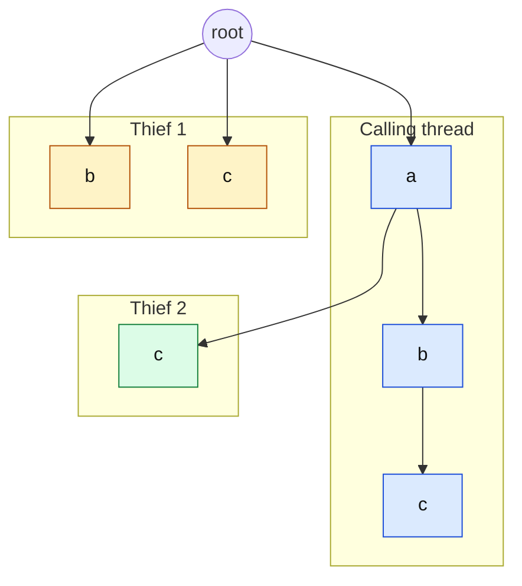

# Parallel brute-force packager

`ParallelBruteForcePackager` is a parallel version of the brute-force packager, for those wishing to use it on a multi-core system.

## Algorithm

It runs the same search as [`BruteForcePackager`](brute-force.md#algorithm) on several threads. By default (`withTreeSearchStealing(true)`) a container's orders are searched as one [tree](brute-force.md#tree-search) on all the threads, with work stealing: the calling thread searches the whole tree, and once it has searched a while (4096 nodes) the other threads join, a thread without work stealing the shallowest subtree another thread has still to search (the types it has still to try at a node within the first six levels), as a part with that node's prefix of placements, which it replays on its own point calculator. A short search, as of a container whose first arrangements place every box, so runs on the calling thread alone, without the hand-off to the threads. The tree's order of search is kept, so the first boxes tried last are pruned with what was found under the first ones, and the threads stay busy. The threads share their best arrangement for pruning, a complete result stops the others, and the results compare by the result comparator, then by their orders: the result is the single-threaded one, except that among several complete arrangements the threads' timing decides, and among equal arrangements of the same order the first found. Containers with few permutations are searched on one thread, with the tree. With `withTreeSearchAnyBest(false)`, containers whose boxes all fit the load limits are split into permutation work units instead: the bound then prunes nothing, and the first complete arrangement wins.



The calling thread searches the tree in its order and is deep under a b, with c still to try at a and b and c still
to try at the root. The first thief takes the types the victim has still to try at the shallowest such node within
the first six levels, b and c at the root, as one part; the victim keeps a. The thief replays the node's prefix of
placements (none at the root) on its own point calculator, then searches the part as a tree of its own. The next
thief steals from whoever has the shallowest node with types left, c at a, and so on until no thread has work.

With `withTreeSearchStealing(false)`, the permutations of the boxes are split into different tasks (the loop), and for box item groups without a box item order, the orders of the groups (by their first groups). The rotations and point placements of a permutation are not split.

```
permutations:   a b c   a c b   b a c   b c a   c a b   c b a       the loop's order
work units:     [  unit 0  ]   [  unit 1  ]   [  unit 2  ]         ranges of consecutive permutations (withParallelizationCount), taken by the threads in turn;
                                                                    a complete arrangement in one unit stops the units after it
```

The parallel packager searches a box item order, or box items with container priorities, on one thread, as the permutations
cannot be split between threads. For box item groups without a box item order, it splits the orders of the groups between
its threads (or, for a few groups with many boxes, the permutations of each order), with the same result as on one thread.

```
group orders:   [A B C] [A C B] | [B A C] [B C A] | [C A B] [C B A]     groups A, B, C
units:              first A     |     first B     |     first C         taken by the threads in turn; within a unit, the orders one at a time
```

## Options

 * `withThreads(..)` and `withAvailableProcessors(..)`: the number of threads (the latter as the available processors divided by a factor).
 * `withParallelizationCount(..)`: the number of units to split the work into, which should be an order of magnitude larger than the number of threads.
 * `withExecutorService(..)`: run the tasks on an executor service of your own.
 * `withPointFilter(..)`, `withSkipReversePermutations(..)`, `withRequireFullSupport(..)`, `withTreeSearch(..)`, `withTreeSearchMinBoxes(..)`: as for the [brute-force packager](brute-force.md#variants); `withTreeSearchStealing(..)`: see above.

## Thread priority

To leave CPU capacity to other work, search at a lower thread priority: `ParallelBruteForcePackager.newBuilder().withThreadPriority(Thread.MIN_PRIORITY)`. The priority is a hint to the operating system's scheduler. Each packing task sets it on the thread which runs it (a pool thread of an executor service passed in with `withExecutorService(..)`, or the calling thread) and restores the thread's own priority afterwards; an executor service created by the builder also creates its threads at the priority. By default, the thread priority is left alone.

## Complexity and limits

The complexity is that of the [brute-force packager](brute-force.md#complexity-and-limits): exponential, so use a deadline.
For box item groups it is also exponential in the number of groups. Benchmark representative inputs before choosing
parallelism; task setup and candidate-selection overhead can outweigh parallel work on small inputs (see
[FEATURES.md](../../FEATURES.md#choosing-an-approach)).

## Tests and benchmarks

 * `ParallelBruteForcePackagerTest`, `ParallelBruteForcePackagerThreadPriorityTest`, `ParallelBruteForcePackagerWorkUnitsTest`, `ParallelGroupOrderSplitTest` and `ParallelBruteForceTreeSearchTest` in `core`, and the `ParallelBoxItem*PermutationRotationIterator*Test` classes in package `iterator`.
 * `ParallelBruteForceEquivalenceIT` in `core` (package `packer.bruteforce.reference`): the parallel search against the 4.x brute force on two and four threads, run with the `slow-tests` profile.
 * `ParallelIteratorBenchmark` in the `jmh` module, see [jmh/README.md](../../jmh/README.md).
