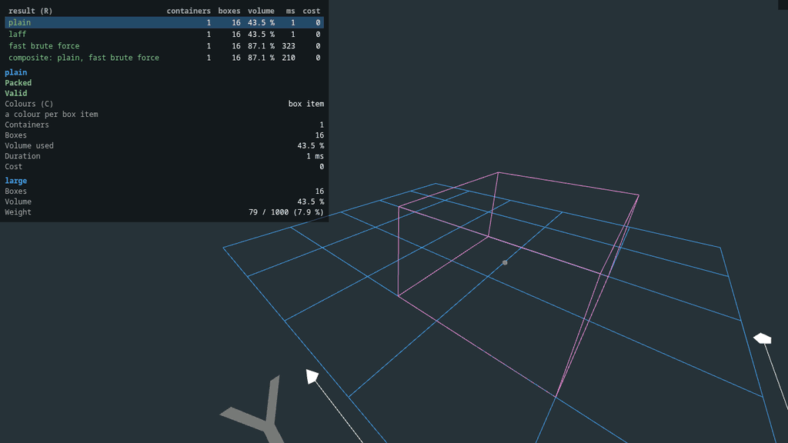
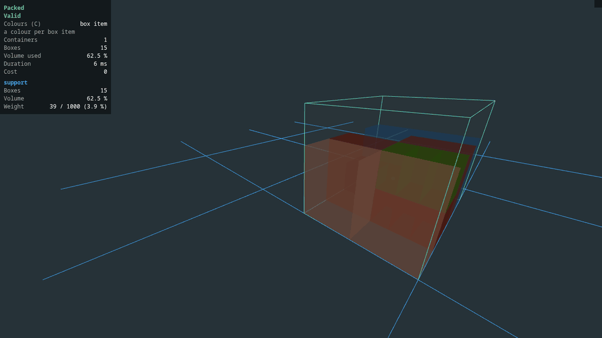
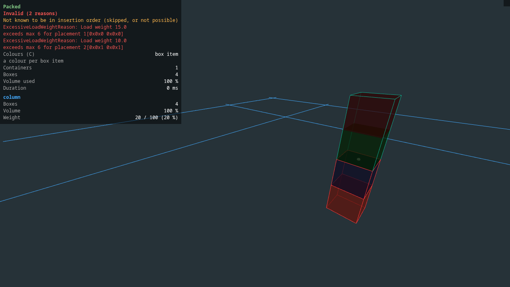
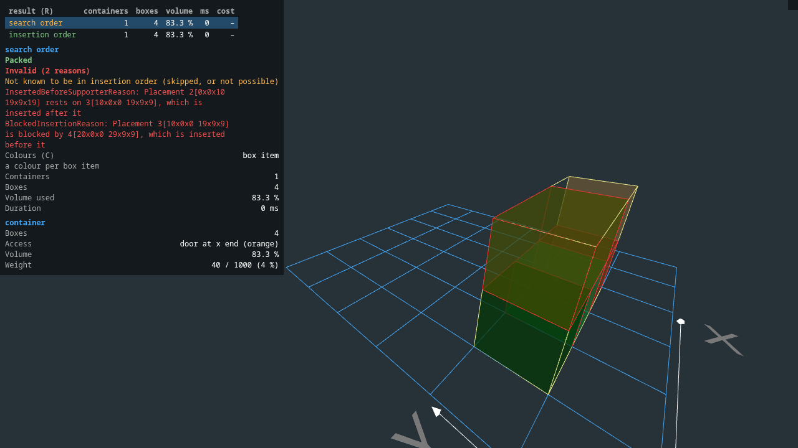
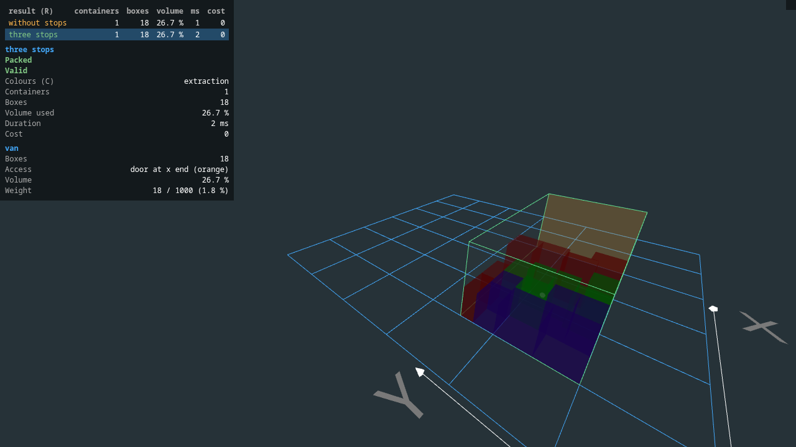

# Visualizer

There is a simple output [visualizer](../visualizer) included in this project, based of [three.js](https://threejs.org/).

This visualizer is currently intended as a tool for developing better algorithms; not as stacking instructions.


*The same order packed by four packagers, one result after the other (`r`): plain and LAFF use the large container (43.5 % of its volume),
fast brute force and the composite packager fit the order in the medium one (87.1 %). The table lists the containers, boxes, volume, time and
cost of each result; the panel below it summarizes the selected result, and the camera fits its containers.*

## Setup
```
cd visualizer/viewer
npm install
```

## Run
```
npm start
```

The viewer shows `visualizer/viewer/public/assets/containers.json`, and reloads it when it changes. Write it with
`DefaultPackagingResultVisualizerFactory` (module `visualizer/packaging`), for one result or several results of the same order:

```java
Map<String, PackagerResult> results = new LinkedHashMap<>();
results.put("plain", plainResult);
results.put("composite", compositeResult);
new DefaultPackagingResultVisualizerFactory(true) // true: calculate the free points after each placement
    .visualize(results, validator.newResultBuilder().withContainerItems(containers).withBoxItems(boxItems), file);
```

## What the viewer shows

 * a summary of the result: whether it was packed, the time and cost, and the volume and weight used per container
 * a comparison table when there are several results (`r` or click a row to switch)
 * whether the result is valid: the factory validates the boxes' load limits (and the whole result, given the input), logs the reasons, and the viewer outlines the boxes of invalid placements in red
 * colour modes (`c`): box item, group, support, load relative to the max load weight, and extraction order
 * the container's opening (orange), and boxes which are not in a possible insertion order
 * each container's centre of gravity, and for each box its supported area and load
 * the packing steps (`a` / `d`) and the free points after each placement (`p`, `w` / `s`)

### Packing steps



*Stepping through the placements with `a`: the boxes appear in the order the packager placed them (here the plain packager, 16 boxes). `d`
steps back, and `p` shows the free points after each placement.*

### Colour modes



*`c` switches the colour mode, which the panel names and explains: a colour per box item, a colour per group (grey without a group), and
support (green: fully supported, red: unsupported). The other two modes colour by the load relative to the box's max load weight, and by the
extraction order.*

### Validation



*A column of four boxes where two exceed their max load weight: the summary says `Invalid (2 reasons)` and lists them
(`ExcessiveLoadWeightReason`: load weight 15.0 exceeds max 6 for the placement), and the viewer outlines the boxes of the invalid
placements in red. Hover a box for its load and the boxes which support it.*

### Insertion order



*A container with a door at the end (orange). Of the two results (`r`), the search order is invalid as an insertion order: one box rests on a
box which would be inserted after it (`InsertedBeforeSupporterReason`), and another is blocked by a box inserted before it
(`BlockedInsertionReason`). The other result is in an insertion order: the boxes can be loaded in the order they are listed in.*

### Extraction order



*A van with a door at the end (orange), loaded for three stops (the second result: the first, without stops, is invalid as the boxes of the
first stop are blocked). `c` colours the boxes by their extraction order.*

## Hot reload and examples

To "hot reload" the visualizer during development, make your unit tests write that file. The `*VisualizationTest`
classes in `visualizer/packaging` are examples (load limits, insertion order, deliveries, groups and support, container
costs, virtual boxes, and comparing packagers); they are run by hand, for example from the IDE or with
`./mvnw -B -ntp -Pdev -pl visualizer/packaging -am -Dtest=PackagerComparisonVisualizationTest -Dsurefire.failIfNoSpecifiedTests=false test`.

For a tour of the features, run `ShowcaseVisualizationTest` while the viewer is open: it writes one scenario after
another, with a delay between them (`-Dshowcase.delay=20` seconds, `-Dshowcase.rounds=3`), and prints what to look
at. The viewer fits the camera when the containers change size.

The images above are from the showcase scenarios (comparing packagers, groups and support, an overloaded column, insertion order and
deliveries), captured from the running viewer with a headless browser; nothing in them is edited.
